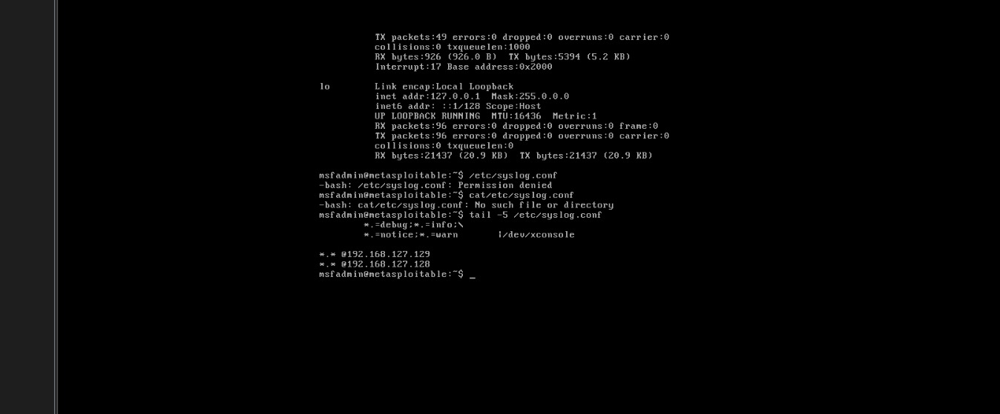
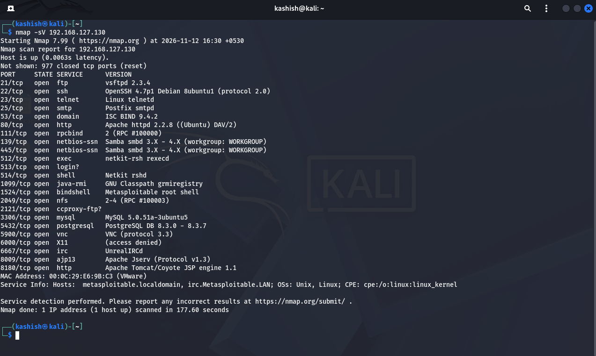
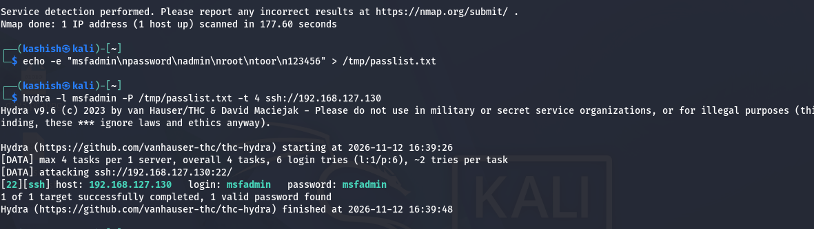
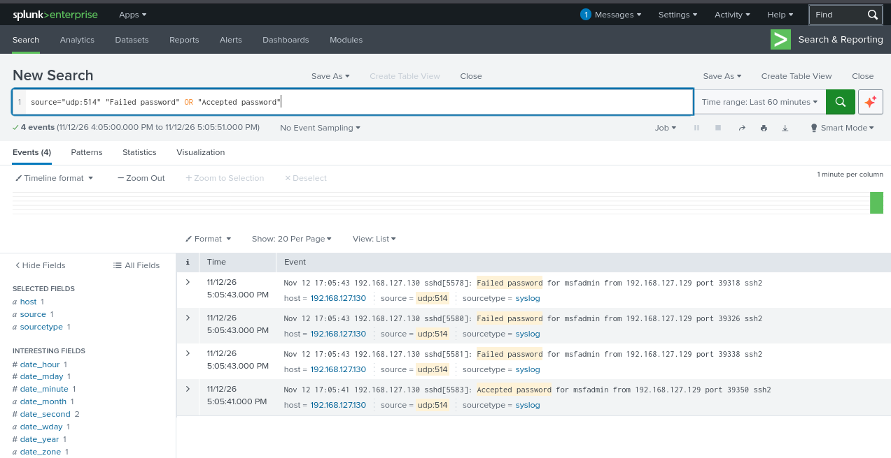
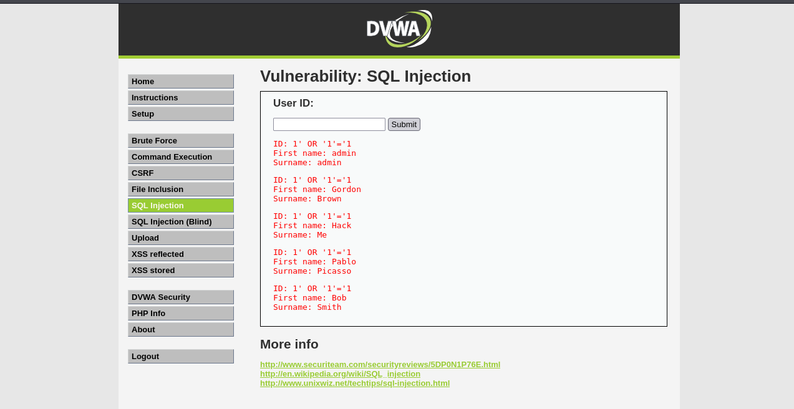
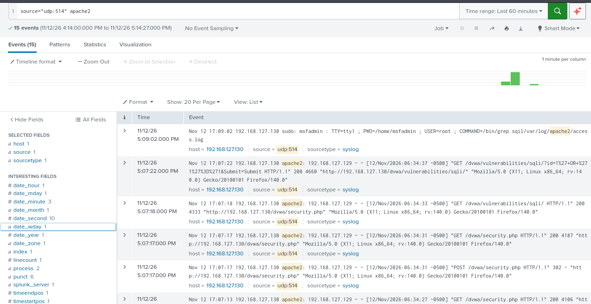

# Home SOC Lab — Attack Simulation & Detection Analysis

A self-built Security Operations Center (SOC) lab simulating real attacker behavior against a vulnerable target, with detection analyzed through log forwarding and Splunk. Built as a hands-on substitute for professional SOC experience, focused on understanding *where* logging pipelines provide visibility — and where they don't.

---

## Architecture

| Component | Details |
|---|---|
| **Attacker / SIEM host** | Kali Linux (`192.168.127.129`) — runs attack tooling (Nmap, Hydra) and Splunk Enterprise |
| **Target** | Metasploitable2 (`192.168.127.130`) — intentionally vulnerable Linux VM |
| **Network** | VMware Host-only subnet, isolated from external traffic |
| **Log transport** | `sysklogd` on Metasploitable2 forwarding over UDP 514 to Splunk |
| **Web app target** | DVWA (Damn Vulnerable Web Application) running on Apache, hosted on Metasploitable2 |

### Key infrastructure note
Metasploitable2 uses **`sysklogd`**, not `rsyslog` — an important distinction, since `rsyslog.conf` is never read on this system. All forwarding configuration lives in `/etc/syslog.conf`.

```
# /etc/syslog.conf — forwarding rule added
*.*     @192.168.127.129
```



---

## Attacks Simulated

### 1. Nmap Service-Version Scan (Reconnaissance)

```bash
nmap -sV 192.168.127.130
```

Full port/service enumeration against the target — 22 open services identified, including vsftpd 2.3.4, OpenSSH 4.7p1, and the well-known Metasploitable2 root bindshell on port 1524.



**Splunk result:** No corresponding events found.
**Why:** Metasploitable2 has no firewall or IDS logging connection attempts at the network layer. Port scanning produces no syslog trace on an unmonitored host — this is expected behavior, not a misconfiguration.


---

### 2. SSH Brute-Force Attack (Hydra)

```bash
hydra -l msfadmin -P /tmp/passlist.txt -t 4 ssh://192.168.127.130
```

Targeted the `msfadmin` account with a small credential list, successfully recovering the password (`msfadmin:msfadmin`).



**Splunk result:** Full attack sequence captured.

```
sshd[xxxx]: Failed password for msfadmin from 192.168.127.129 port xxxxx ssh2
sshd[xxxx]: Failed password for msfadmin from 192.168.127.129 port xxxxx ssh2
sshd[xxxx]: Accepted password for msfadmin from 192.168.127.129 port xxxxx ssh2
```



**Why it worked:** SSH authentication logs through PAM to syslog by default, and the forwarding pipeline was functioning correctly — this is the detection success case, and the baseline for what working log coverage looks like.

**Detection logic:** Multiple `Failed password` events for a single account from one source IP within a short time window, followed by an `Accepted password` event, is a reliable correlation signature for brute-force-then-compromise.

---

### 3. SQL Injection via DVWA

Payload used against the SQL Injection module (Low security):

```
1' OR '1'='1
```

Returned the entire `users` table instead of a single record — confirming classic authentication-bypass SQL injection.



**Initial Splunk result:** No events found — despite the attack succeeding.

**Root cause investigation:** Checked Apache's local access log directly on Metasploitable2 — the exact payload was present, locally logged and URL-encoded:

```
GET /dvwa/vulnerabilities/sqli/?id=1%27+or+%271%27+%3D+%271&Submit=Submit HTTP/1.1" 200 4670
```

**Finding:** Apache logs to its own local files by default — not through syslog — so it was never included in the existing forwarding rule. The attack was fully evidenced on disk and completely invisible to the SIEM. A real log source coverage gap, not a tooling failure.

---

## Remediation: Closing the Apache → Syslog Gap

Rather than stop at "found a gap," the fix was implemented and validated end-to-end.

**Change made** in `/etc/apache2/sites-available/default`:

```apache
# Before
CustomLog /var/log/apache2/access.log combined

# After
CustomLog "|/usr/bin/logger -t apache2 -p local1.info" combined
```

This pipes every Apache access log line through `logger`, tagging it and injecting it into syslog under the `local1` facility — riding the same existing forwarding rule already carrying SSH/cron/daemon logs to Splunk.

```bash
sudo /etc/init.d/apache2 restart
```

**Validation:** Re-ran the SQL injection payload after the fix and confirmed the event now appears in Splunk, tagged `apache2:`:

```
Nov 12 17:07:22 metasploitable apache2: 192.168.127.129 - - [12/Nov/2026:06:34:37 -0500] "GET /dvwa/vulnerabilities/sqli/?id=1%27+OR+%271%27%3D%271&Submit=Submit HTTP/1.1" 200 4660
```



The blind spot identified in Attack 3 is now closed — Apache web traffic is fully visible in the SIEM alongside host-level logs.

---

## Key Takeaway: Visibility Is Not Uniform

The central lesson of this lab: **a functioning log pipeline does not guarantee complete coverage.** Three attacks produced three different outcomes, for three different reasons:

| Attack | Local evidence | Reached SIEM | Root cause |
|---|---|---|---|
| Nmap scan | None | No | No monitoring mechanism exists for this activity at all |
| SSH brute force | Yes (`auth.log`) | Yes | Logs through PAM → syslog by default; pipeline was correctly configured |
| SQL injection | Yes (`access.log`) | **Initially no, later yes** | Apache logs locally by default; wasn't wired into the syslog forwarding scope |

Each of these requires a different kind of fix — new tooling (IDS/firewall logging) for the first, nothing for the second, and a configuration change for the third. Recognizing *which* gap you're looking at, and why, is the actual skill being demonstrated here — not just running attack tools.

---

## Tools Used

- **VMs:** Kali Linux, Metasploitable2 — VMware, Host-only networking
- **SIEM:** Splunk Enterprise (on Kali), receiving syslog via UDP 514
- **Attack tools:** Nmap, Hydra, DVWA
- **Log infrastructure:** `sysklogd` (Metasploitable2), `logger` for custom facility tagging

---

## Possible Next Steps

- Extend forwarding coverage to Apache `error.log` as well as `access.log`
- Add a basic correlation rule / alert in Splunk for the SSH brute-force signature
- Introduce a second attack technique (e.g. XSS, directory traversal) and repeat the visibility-gap analysis
- Add a lightweight IDS (e.g. Suricata) to close the Nmap visibility gap
